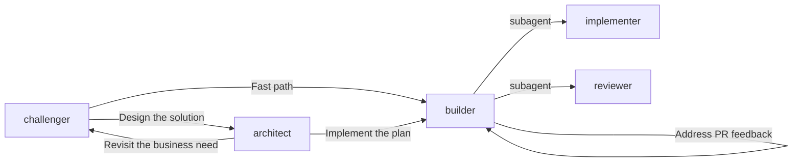

# Components

The plugin modules, their responsibilities, and where new code goes.

## Agents

| Agent | Visible | Model | Tools | Skills loaded | Source |
|---|---|---|---|---|---|
| `challenger` | yes | Claude Opus | read, search, edit, todo, `ado-read/*` | delivery-workflow, business-challenge, azure-devops | `com.github.copilot/agents/challenger.agent.md` |
| `architect` | yes | Claude Opus | read, search, edit, todo, web, `ado-read/*` | delivery-workflow, solution-design, architecture-mapping | `com.github.copilot/agents/architect.agent.md` |
| `builder` | yes | Claude Sonnet | read, search, edit, execute, todo, agent, `ado-read/*`, `ado-write/*` | delivery-workflow, plan-execution, red-green-refactor, azure-devops, pr-feedback | `com.github.copilot/agents/builder.agent.md` |
| `implementer` | no (subagent) | Claude Sonnet | read, search, edit, execute, todo | plan-execution, red-green-refactor | `com.github.copilot/agents/implementer.agent.md` |
| `reviewer` | no (subagent) | GPT | read, search, edit, execute | code-review | `com.github.copilot/agents/reviewer.agent.md` |

Only the builder has `ado-write` and can run subagents. Handoffs link challenger → architect or builder (fast path), architect → builder or challenger, and builder → builder (PR feedback).

## Skills

| Skill | Responsibility | Source |
|---|---|---|
| `delivery-workflow` | Shared conventions: `.ai/` artifacts, `state.json` phases, fast/standard/feature paths, language, project contract, skill precedence, gates | `skills/delivery-workflow/` |
| `business-challenge` | Challenge the need, Definition of Ready, `brief.md` | `skills/business-challenge/` |
| `solution-design` | Options, ADR, checklists (security, performance, testing, reliability), `plan.md` in lots, documentation impact | `skills/solution-design/` |
| `plan-execution` | Builder and implementer procedures, review loop bounded to 2 iterations | `skills/plan-execution/` |
| `red-green-refactor` | Test-first discipline: failing test, minimal code, refactor; `TDD cycle` evidence in the lot report, checked by the builder; a code commit without tests needs the user's approval (`PreToolUse`) | `skills/red-green-refactor/` |
| `code-review` | Independent review of `merge-base..HEAD`, severities, `review.md` | `skills/code-review/` |
| `pr-feedback` | Triage of PR comments (fix, discuss, decline), fixes, `🤖` replies | `skills/pr-feedback/` |
| `azure-devops` | Use of the MCP servers: work item intake, draft PR creation, comments | `skills/azure-devops/` |
| `project-onboarding` | Onboarding of a target project and the `onboard.py` script | `skills/project-onboarding/` |
| `architecture-mapping` | The `docs/architecture/` map: creation, `--refresh`, reading and updating during a delivery | `skills/architecture-mapping/` |

Precedence rule: the target project's skills win over the plugin's, and the plugin checklists only cover topics no project skill covers (`skills/delivery-workflow/SKILL.md`).

## Hooks

| Module | Responsibility | Source |
|---|---|---|
| `workflow_gate.py` | Shared library: input parsing (VS Code Local and Copilot formats), active workflow loading, git calls, `review.md` front matter, review gate, output format | `scripts/hooks/workflow_gate.py` |
| `pre_tool_use.py` | `PreToolUse` policy: parses shell commands (git, az, nested shell launchers) and Azure DevOps MCP tools; test-first gate on commits (code without a test file asks the user) | `scripts/hooks/pre_tool_use.py` |
| `stop.py` | Review gate when the agent stops in the `build` or `feedback` phase | `scripts/hooks/stop.py` |

Allowed dependencies: `pre_tool_use.py` and `stop.py` import `workflow_gate.py`, and nothing outside the Python standard library (`README.md`, script imports).

## Where new code goes

- A new method or procedure: in a skill (`skills/<name>/SKILL.md`, with `assets/` and `references/`). Agents stay thin (`README.md`).
- A new deterministic gate: in `scripts/hooks/`, with its tests in `tests/test_pre_tool_use.py` or `tests/test_stop.py`.
- A new agent: `com.github.copilot/agents/<name>.agent.md`; `tests/test_plugin_structure.py` checks the consistency of agents, referenced skills and hooks.
