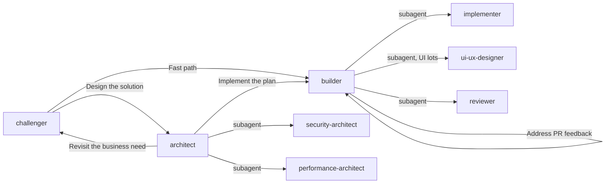

# Components

The plugin modules, their responsibilities, and where new code goes.

## Agents

| Agent | Visible | Model | Tools | Skills loaded | Source |
|---|---|---|---|---|---|
| `challenger` | yes | Claude Opus | read, search, edit, todo, `ado-read/*` | delivery-workflow, business-challenge, azure-devops | `com.github.copilot/agents/challenger.agent.md` |
| `architect` | yes | Claude Opus | read, search, edit, todo, agent, web, `ado-read/*` | delivery-workflow, solution-design, architecture-mapping | `com.github.copilot/agents/architect.agent.md` |
| `builder` | yes | Claude Sonnet | read, search, edit, execute, todo, agent, `ado-read/*`, `ado-write/*` | delivery-workflow, plan-execution, azure-devops, pr-feedback | `com.github.copilot/agents/builder.agent.md` |
| `implementer` | no (subagent) | Claude Sonnet | read, search, edit, execute, todo | plan-execution | `com.github.copilot/agents/implementer.agent.md` |
| `ui-ux-designer` | no (builder subagent) | Claude Sonnet | read, search, edit, execute, todo | ui-ux-design, plan-execution | `com.github.copilot/agents/ui-ux-designer.agent.md` |
| `security-architect` | yes, and architect subagent | Claude Opus | read, search, edit, todo, web, `ado-read/*` | delivery-workflow, security-design | `com.github.copilot/agents/security-architect.agent.md` |
| `performance-architect` | yes, and architect subagent | Claude Opus | read, search, edit, todo, web, `ado-read/*` | delivery-workflow, performance-design | `com.github.copilot/agents/performance-architect.agent.md` |
| `reviewer` | no (subagent) | GPT, then Gemini (another family than the implementer) | read, search, edit, execute | code-review | `com.github.copilot/agents/reviewer.agent.md` |

Only the builder has `ado-write`. The builder runs the implementer, the ui-ux-designer (lots marked `Kind: ui`) and the reviewer; the architect runs the security-architect and the performance-architect when the concern is flagged ([ADR 0007](./decisions/0007-specialist-agents.md)). Handoffs link challenger → architect or builder (fast path), architect → builder or challenger, and builder → builder (PR feedback).

## Skills

| Skill | Responsibility | Source |
|---|---|---|
| `delivery-workflow` | Shared conventions: `.ai/` artifacts, `state.json` phases, fast/standard/feature paths, language, project contract, skill precedence, gates | `skills/delivery-workflow/` |
| `business-challenge` | Challenge the need, Definition of Ready, `brief.md` | `skills/business-challenge/` |
| `solution-design` | Options, ADR, specialist consultation, checklists (design, testing, reliability), `plan.md` in lots (`Kind: ui | code`), documentation impact | `skills/solution-design/` |
| `plan-execution` | Builder and implementer procedures, review loop bounded to 2 iterations | `skills/plan-execution/` |
| `code-review` | Independent review of `merge-base..HEAD`, severities, `review.md` | `skills/code-review/` |
| `pr-feedback` | Triage of PR comments (fix, discuss, decline), fixes, `🤖` replies | `skills/pr-feedback/` |
| `azure-devops` | Use of the MCP servers: work item intake, draft PR creation, comments | `skills/azure-devops/` |
| `project-onboarding` | Onboarding of a target project and the `onboard.py` script | `skills/project-onboarding/` |
| `ui-ux-design` | UI lots: design system first, WCAG 2.1 AA, states, responsive, i18n, visual evidence | `skills/ui-ux-design/` |
| `security-design` | Threat model (STRIDE), `SEC-n` requirements per lot, `security.md`; security checklist | `skills/security-design/` |
| `performance-design` | Budgets, hot paths, measurement plan, `PERF-n` requirements per lot, `performance.md`; performance checklist | `skills/performance-design/` |
| `dotnet-performance` | .NET only: Tier A defaults and Tier B hot-path techniques, each sourced; BenchmarkDotNet evidence; `ms-learn` documentation tools ([ADR 0008](./decisions/0008-stack-specific-performance-skills.md)) | `skills/dotnet-performance/` |
| `architecture-mapping` | The `docs/architecture/` map: creation, `--refresh`, reading and updating during a delivery | `skills/architecture-mapping/` |

The stage skills (`business-challenge`, `solution-design`, `plan-execution`, `code-review`, `pr-feedback`; the new `ui-ux-design`, `security-design` and `performance-design` say the same in their description) and `delivery-workflow` are `user-invocable: false` and say they apply only within the workflow, so they do not trigger on unrelated requests; `project-onboarding`, `architecture-mapping` and `azure-devops` stay invocable.

Precedence rule: the target project's skills win over the plugin's, and the plugin checklists only cover topics no project skill covers (`skills/delivery-workflow/SKILL.md`).

## Hooks

| Module | Responsibility | Source |
|---|---|---|
| `workflow_gate.py` | Shared library: input parsing (VS Code Local and Copilot formats), workflow loading without git, git calls, `review.md` front matter, review gate, hook-owned state, heartbeat, decision log and redaction, Azure DevOps coordinates of `origin`, output format | `scripts/hooks/workflow_gate.py` |
| `state_policy.py` | File edits: simulation of the edit, `state.json` transitions, `review.md` ownership and iteration, hook-owned files, role boundaries | `scripts/hooks/state_policy.py` |
| `pre_tool_use.py` | `PreToolUse` entry point: shell commands (git push, az, HTTP, wrappers, launchers, interpreters), Azure DevOps MCP tools, then `state_policy` for file edits | `scripts/hooks/pre_tool_use.py` |
| `stop.py` | Review gate (`build`, `feedback`) and record gate (`pr-open`), consecutive block count | `scripts/hooks/stop.py` |
| `user_prompt.py` | `UserPromptSubmit`: time of the user's last prompt, heartbeat | `scripts/hooks/user_prompt.py` |
| `subagent.py` | `SubagentStart` / `SubagentStop`: reviewer and implementer markers | `scripts/hooks/subagent.py` |
| `close_workflow.py` | Close step: `phase: done`, archive, clear `.ai/current` (run by the builder or the user) | `scripts/close_workflow.py` |

Allowed dependencies: every hook imports `workflow_gate.py`; `pre_tool_use.py` also imports `state_policy.py`; nothing outside the Python standard library ([ADR 0003](./decisions/0003-standard-library-python-hooks.md)).

## Where new code goes

- A new method or procedure: in a skill (`skills/<name>/SKILL.md`, with `assets/` and `references/`). Agents stay thin (`README.md`).
- A new deterministic gate: in `scripts/hooks/`, documented in `skills/delivery-workflow/references/gates.md`, with its tests in `tests/` (bypass cases in `tests/test_bypass_corpus.py`).
- A new agent: `com.github.copilot/agents/<name>.agent.md`; `tests/test_plugin_structure.py` checks the consistency of agents, referenced skills and hooks.
