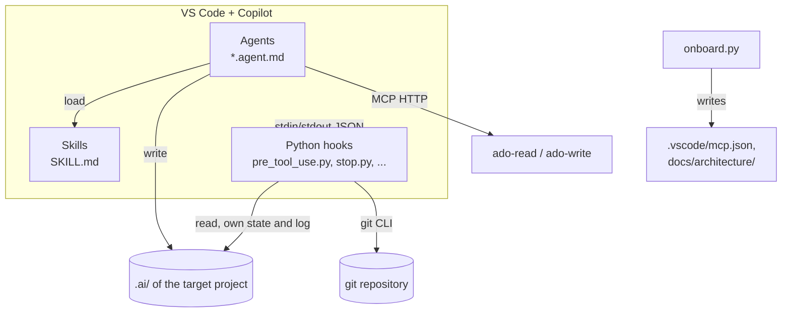

# Containers

The units that make up the plugin and how they communicate (C4 level 2). Nothing is deployed: VS Code loads everything locally, from a clone or an install from source (`README.md`).

| Unit | Technology | Responsibility | Source |
|---|---|---|---|
| Manifest | Agent Plugins 1.0 JSON | Name, version, source repository; releases in `CHANGELOG.md` | `plugin.json` |
| Agents | Markdown + front matter (`*.agent.md`) | 5 interactive agents (challenger, architect, security-architect, performance-architect, builder) and 3 hidden subagents (implementer, ui-ux-designer, reviewer); the two specialists also run as architect subagents | `com.github.copilot/agents/` |
| Skills | Markdown (`SKILL.md`) + assets and references | The whole method: procedures, templates, checklists | `skills/` |
| Hooks | Python ≥ 3.9, standard library only | Deterministic `UserPromptSubmit`, `PreToolUse`, `SubagentStart`, `SubagentStop` and `Stop` gates | `com.github.copilot/hooks/hooks.json`, `scripts/hooks/` |
| Close step | Python, standard library | Ends a workflow: `phase: done`, archive, `.ai/current` removed | `scripts/close_workflow.py` |
| Onboarding script | Python, standard library | Sets up a target project (`.vscode/mcp.json`, `.git/info/exclude`, `docs/architecture/` skeleton) | `skills/project-onboarding/scripts/onboard.py` |
| `.ai/` working files | Markdown and JSON in the target project, never committed | Workflow state and artifacts, hook state and decision log | `skills/delivery-workflow/SKILL.md` |
| Test suite | `unittest` | Tests of the hooks, the onboarding script and the plugin structure | `tests/`, `azure-pipelines.yml` |

## Communication

- VS Code runs the hooks as subprocesses (`python3` under bash, `python` under PowerShell) with a 15 s timeout, and passes the event as JSON on stdin; each hook answers one JSON object on stdout (`com.github.copilot/hooks/hooks.json`, `scripts/hooks/workflow_gate.py`).
- The hooks read the workflow state in `.ai/`, write their own state and log there, and call git as a subprocess (`scripts/hooks/workflow_gate.py`).
- The agents talk to Azure DevOps through the `ado-read` and `ado-write` HTTP MCP servers, declared in the target project's `.vscode/mcp.json` (`skills/project-onboarding/scripts/onboard.py`).
- The builder delegates to the `implementer` and `reviewer` subagents, which do not see its conversation (`com.github.copilot/agents/builder.agent.md`).

