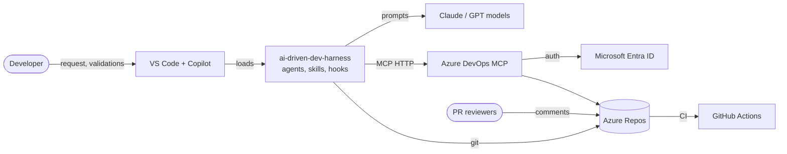

# Context

Who uses the plugin, and which external systems it talks to (C4 level 1).

## The system

`ai-driven-dev-harness` is an agent plugin in the Agent Plugins 1.0 format (`plugin.json`) for VS Code and GitHub Copilot. It turns a request (prompt, spec or Azure DevOps work item) into a reviewed **Azure Repos draft PR** (`README.md`, `skills/delivery-workflow/SKILL.md`). Nothing runs as a long-lived application: the plugin is a set of agents, skills and hooks loaded by the host (VS Code).

## Actors

| Actor | Role | Source |
|---|---|---|
| Developer (user) | Gives the request, validates the brief and the plan, confirms the push and the PR creation, reviews and publishes the PR | `README.md`, `skills/delivery-workflow/SKILL.md` |
| Human PR reviewers | Comment on the draft PR in Azure DevOps; the builder handles their threads | `skills/pr-feedback/SKILL.md` |

## External systems

| System | Use | Source |
|---|---|---|
| VS Code + GitHub Copilot (Local harness) | Host: loads the agents, skills and handoffs, and runs the hooks | `README.md`, `com.github.copilot/hooks/hooks.json` |
| Language models through Copilot | Claude (challenger, architect, builder, implementer) and GPT, with a Gemini fallback (reviewer, another model family) | `com.github.copilot/agents/*.agent.md` |
| Azure DevOps remote MCP server | Reads work items, repos and wiki (`ado-read`); creates the draft PR and comments (`ado-write`) | `skills/azure-devops/SKILL.md`, `skills/project-onboarding/scripts/onboard.py` |
| Microsoft Entra ID | Authenticates the MCP servers with the user's identity | `README.md`, `skills/azure-devops/SKILL.md` |
| Git and the `origin` remote (Azure Repos) | Work branch `ai/<slug>`, push, review baseline | `skills/plan-execution/SKILL.md`, `scripts/hooks/workflow_gate.py`, `plugin.json` |
| GitHub Actions | Runs the plugin test suite | `.github/workflows/ci.yml` |

