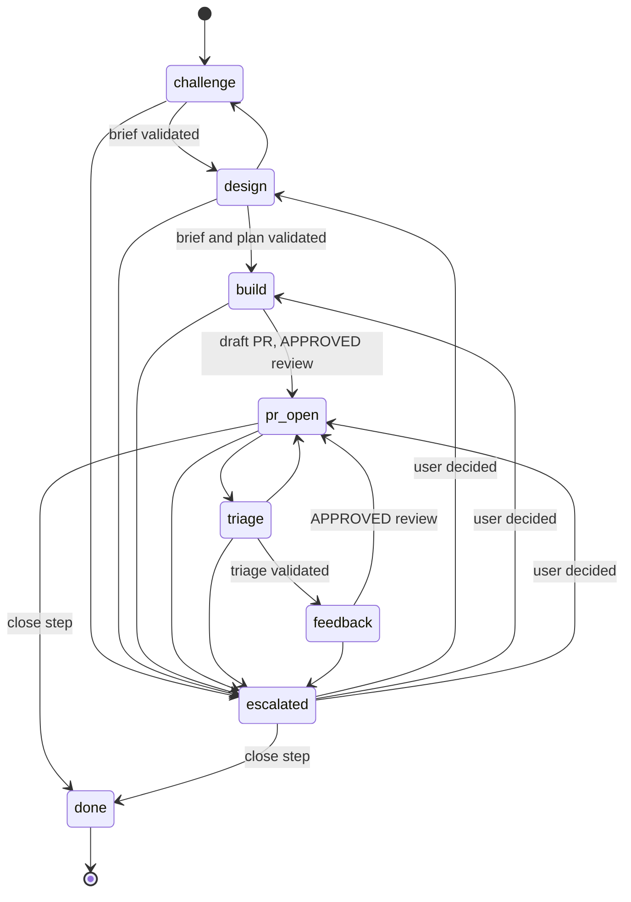

# Data

The plugin has no database. Its state lives in files of the target project.

## Stores

| Store | Content | Committed | Written by | Source |
|---|---|---|---|---|
| `.ai/current` | Slug of the active work | no (`.git/info/exclude`) | challenger, close step | `skills/delivery-workflow/SKILL.md` |
| `.ai/<slug>/state.json` | Workflow state; every edit is checked by the hooks | no | the agent of the current stage | `skills/delivery-workflow/assets/state-template.json`, `scripts/hooks/state_policy.py` |
| `.ai/<slug>/brief.md`, `plan.md`, `pr-description.md`, `feedback.md` | Artifacts of each stage | no | challenger, architect, builder | `skills/delivery-workflow/SKILL.md` |
| `.ai/<slug>/security.md`, `performance.md` | Specialist analyses and their `SEC-n`, `PERF-n` requirements | no | security-architect, performance-architect | `skills/security-design/`, `skills/performance-design/` |
| `.ai/<slug>/review.md` | Latest review; its front matter is read by the hooks | no | reviewer | `skills/code-review/SKILL.md` |
| `.ai/<slug>/.hooks.json` | Heartbeat (time, plugin version), `user_prompt_at`, `written_at` and `validated_at` per artifact, `escalated_at`, `untracked_baseline`, `stop_blocks` | no | hooks only | `scripts/hooks/workflow_gate.py`, `state_policy.py`, `user_prompt.py`, `stop.py` |
| `.ai/<slug>/log.jsonl` | One JSON line per hook decision: `at`, `hook`, `tool`, `decision`, `reason`, `head`, `phase` | no | hooks only (append-only) | `log_event` in `scripts/hooks/workflow_gate.py` |
| `.ai/<slug>/usage.json` | Token usage per agent (schema below) | no | hooks only (`Stop`, `SubagentStart`, `SubagentStop`) | `scripts/hooks/usage.py` |
| `.ai/<slug>/.<subagent>-active` | Subagent markers (reviewer, implementer, ui-ux-designer, security-architect, performance-architect) | no | hooks only | `scripts/hooks/subagent.py` |
| `.ai/archive/<slug>/` | Closed workflows | no | close step | `scripts/close_workflow.py` |
| `.vscode/mcp.json` | `ado-read` and `ado-write` declarations | excluded when created by the script and untracked | `onboard.py` | `skills/project-onboarding/scripts/onboard.py` |
| `docs/architecture/` | Architecture map | yes | architecture-mapping, implementer | `skills/architecture-mapping/SKILL.md` |
| `AGENTS.md` (AI delivery workflow section) | Project contract | yes | project-onboarding | `skills/project-onboarding/assets/agents-md-section.md` |

## `state.json` model

| Field | Values | Read by the hooks |
|---|---|---|
| `slug` | kebab-case, 40 characters max, prefixed with the work item ID (`SLUG_RE`) | yes: must match the folder |
| `phase` | see the diagram | yes: `done` disables the hooks, `build` and `feedback` enable the review gate, `pr-open` the record gate, only `build` allows PR creation; transitions are validated |
| `path` | `fast`, `standard`, `feature` | no |
| `base_branch`, `branch` | target branch, always `ai/<slug>` | `base_branch`: PR target, fixed once the build starts; `branch`: must be `ai/<slug>` (the hooks never trust it) |
| `work_item` | ID or `null` | no |
| `brief_validated`, `plan_validated` | `{"at", "head"}` or `null` | yes: required to enter `design` and `build`, need a user prompt after the last write of the file |
| `lots_done` | append-only list of `{"lot", "commit"}` | yes: append-only within a cycle |
| `pull_request`, `record_thread` | ID or `null`, set once | yes: PR and comment writes are scoped to `pull_request`; `record_thread` ends the record gate |
| `review_iterations` | 0 to 2 | yes: +1 per reviewer run, reset to 0 when a cycle starts, equal to the `iteration` of `review.md` |
| `escalation` | `{"from", "reason"}` | yes: required to enter `escalated` |
| `language` | language of the request | no |
| `closed_at`, `closed_from`, `close_reason` | written by the close step | no |

Sources: `skills/delivery-workflow/SKILL.md`, `TRANSITIONS` and `check_state_write` in `scripts/hooks/state_policy.py`, `STOP_GATED_PHASES` and `PR_CREATION_PHASES` in `scripts/hooks/workflow_gate.py`.

From `escalated` the user may also send the workflow back to `challenge`, `triage` or `feedback`; the close step can end the workflow from any phase.

## `review.md` front matter

The hooks read `verdict` (`APPROVED` or `CHANGES_REQUESTED`), `reviewed_sha` (must be a prefix of HEAD), `base_sha` and `iteration` (`skills/code-review/SKILL.md`, `read_frontmatter` in `scripts/hooks/workflow_gate.py`). Files are read as UTF-8 with or without BOM, UTF-16 with BOM, or cp1252 (`read_text`).

## Sensitive data

- `.ai/` artifacts can copy work item content (description, acceptance criteria, comments). They stay local and are never committed (`skills/delivery-workflow/SKILL.md`).
- `onboard.py` strips credentials from the remote URL before printing it (`redact_remote`).
- The architecture map holds no secrets or internal URLs (`skills/architecture-mapping/SKILL.md`).

## `usage.json` model

Written by the hooks only (`scripts/hooks/usage.py`), read by `scripts/usage_report.py` and by any read-only tool such as a dashboard. Credits are not stored: they are computed at report time from `scripts/hooks/pricing.json`, so a rate change applies to past workflows too (`usage_report.py --json` gives the computed summary).

| Field | Content |
|---|---|
| `version` | `1` |
| `updated_at` | ISO time of the last write |
| `agents.<name>` | One entry per agent: `challenger`, `architect`, `builder`, a workflow subagent, or another subagent by its name |
| `agents.<name>.runs`, `turns` | Subagent launches (`SubagentStop`); main agent turns (`Stop`) |
| `agents.<name>.duration_s` | Total run time of a subagent, from its marker |
| `agents.<name>.requests` | Model requests attributed to the agent |
| `agents.<name>.models.<model>` | `requests`, `input`, `cached_input`, `cache_write`, `output` (tokens; `input` excludes cached and cache-write tokens), and `long_context_requests` (requests above 100K prompt tokens, priced at the long-context rate when their model has one) |
| `transcripts.<path>` | Read cursor of each transcript: `offset`, `seen` (request ids already counted), `read_at` |
| `missing_transcript` | Hook events that carried no transcript path |

