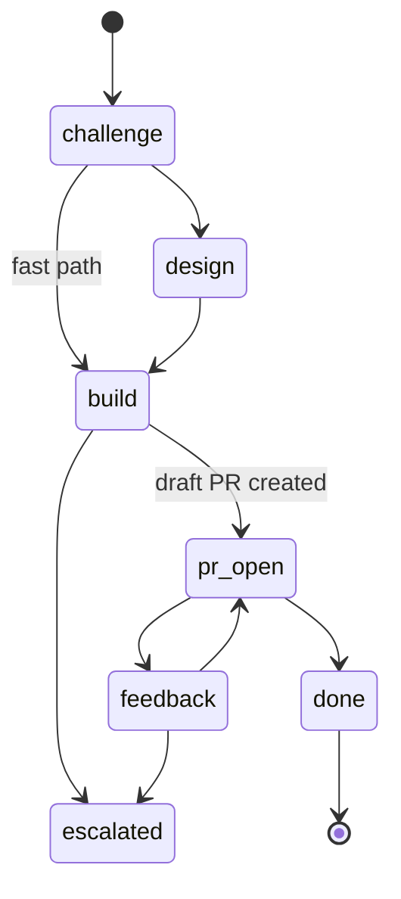

# Data

The plugin has no database. Its state lives in files of the target project.

## Stores

| Store | Content | Committed | Written by | Source |
|---|---|---|---|---|
| `.ai/current` | Slug of the active work | no (`.git/info/exclude`) | challenger | `skills/delivery-workflow/SKILL.md` |
| `.ai/<slug>/state.json` | Workflow state | no | every agent | `skills/delivery-workflow/assets/state-template.json` |
| `.ai/<slug>/brief.md`, `plan.md`, `pr-description.md`, `feedback.md` | Artifacts of each stage | no | challenger, architect, builder | `skills/delivery-workflow/SKILL.md` |
| `.ai/<slug>/review.md` | Latest review; its front matter is read by the hooks | no | reviewer | `skills/code-review/SKILL.md` |
| `.vscode/mcp.json` | `ado-read` and `ado-write` declarations | excluded when created by the script and untracked | `onboard.py` | `skills/project-onboarding/scripts/onboard.py` |
| `docs/architecture/` | Architecture map | yes | architecture-mapping, implementer | `skills/architecture-mapping/SKILL.md` |
| `AGENTS.md` (AI delivery workflow section) | Project contract | yes | project-onboarding | `skills/project-onboarding/assets/agents-md-section.md` |

## `state.json` model

| Field | Values | Read by the hooks |
|---|---|---|
| `slug` | kebab-case, 40 characters max, prefixed with the work item ID | through `.ai/current` |
| `phase` | `challenge` → `design` → `build` → `pr-open` ⇄ `feedback` → `done`, or `escalated` | yes: `done` disables the hooks, `build` and `feedback` enable the review gate, only `build` allows PR creation |
| `path` | `fast`, `standard`, `feature` | no |
| `base_branch`, `branch` | target branch, `ai/<slug>` | `base_branch`: yes |
| `work_item`, `pull_request` | ID or `null` | no |
| `review_iterations` | integer, 2 max per cycle | no |
| `language` | language of the request | no |

Sources: `skills/delivery-workflow/SKILL.md`, `scripts/hooks/workflow_gate.py` (`INACTIVE_PHASES`, `STOP_GATED_PHASES`, `PR_CREATION_PHASES`).

## `review.md` front matter

The hooks read `verdict` (`APPROVED` or `CHANGES_REQUESTED`), `reviewed_sha` (must be a prefix of HEAD), `base_sha` and `iteration` (`skills/code-review/SKILL.md`, `read_frontmatter` in `scripts/hooks/workflow_gate.py`). Files are read as UTF-8 with or without BOM, UTF-16 with BOM, or cp1252 (`read_text`).

## Sensitive data

- `.ai/` artifacts can copy work item content (description, acceptance criteria, comments). They stay local and are never committed (`skills/delivery-workflow/SKILL.md`).
- `onboard.py` strips credentials from the remote URL before printing it (`redact_remote`).
- The architecture map holds no secrets or internal URLs (`skills/architecture-mapping/SKILL.md`).
