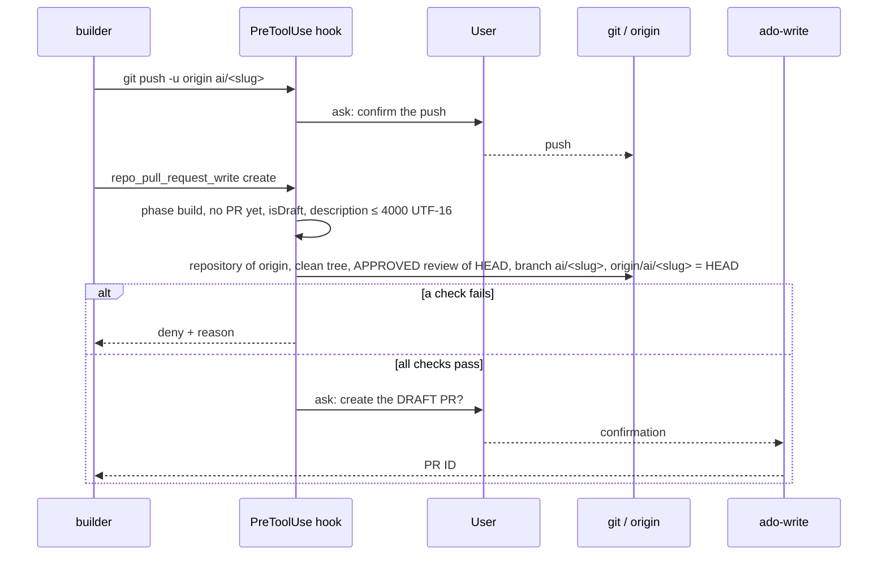
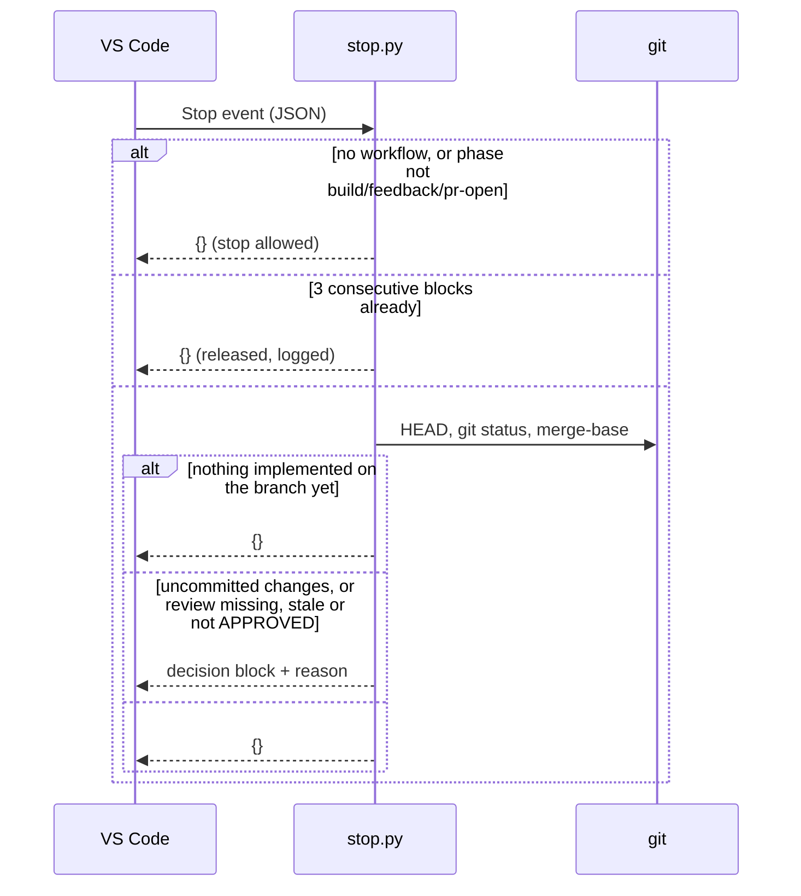

# Integrations

The external systems the plugin calls, then the critical flows.

| System | Purpose | Protocol | Authentication | Timeout, retry | Source |
|---|---|---|---|---|---|
| Azure DevOps MCP server `ado-read` | Work items, repos, wiki, read-only | MCP over HTTP, headers `X-MCP-Readonly: true` and `X-MCP-Toolsets: repos,wit,wiki` | Microsoft Entra ID, user's identity | Not handled by the plugin. On failure, the agent asks the user to paste the work item | `skills/project-onboarding/scripts/onboard.py`, `skills/azure-devops/SKILL.md` |
| Azure DevOps MCP server `ado-write` | `repo_pull_request_write` and `repo_pull_request_thread_write` only | MCP over HTTP, `X-MCP-Tools` header | Microsoft Entra ID, user's identity | Not handled. On failure, the builder hands `pr-description.md` to the user for a manual PR | same |
| Git (`origin` remote) | Work branch, push, working tree status, reviewed SHAs, Azure DevOps coordinates of `origin` | `git` CLI as a subprocess | User's git credentials | 4 s per call in the hooks, no retry; the repository root is found without git | `scripts/hooks/workflow_gate.py` |
| VS Code / Copilot host | Calls the hooks on `UserPromptSubmit`, `PreToolUse`, `SubagentStart`, `SubagentStop` and `Stop` | Subprocess, JSON on stdin/stdout | n/a | 15 s per hook | `com.github.copilot/hooks/hooks.json` |

The MCP server URL is built from the organization of the `origin` remote (`MCP_ENDPOINT` in `skills/project-onboarding/scripts/onboard.py`). The `az` CLI and direct HTTP calls are never used to write to Azure DevOps (`scripts/hooks/pre_tool_use.py`).

## Flow: draft PR creation

Source: `skills/plan-execution/SKILL.md`, `scripts/hooks/pre_tool_use.py` (`evaluate_pr_create`).

## Flow: review gate on stop

Source: `scripts/hooks/stop.py`, `scripts/hooks/workflow_gate.py` (`review_gate`).

Any exception in `stop.py` lets the agent stop and is logged. In `pre_tool_use.py`, an exception denies Azure DevOps write tools and writes mentioning protected workflow files, never other tools, and is logged (`main` in both scripts).
