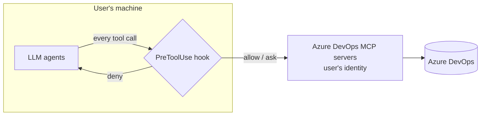

# Security

How the plugin limits what the agents can do with the user's identity.

## Authentication

- The `ado-read` and `ado-write` MCP servers authenticate with Microsoft Entra ID and act **with the user's identity** (`skills/azure-devops/SKILL.md`). The plugin stores no token or secret: `.vscode/mcp.json` only holds the URL and filtering headers (`desired_servers` in `skills/project-onboarding/scripts/onboard.py`).
- Git uses the credentials the user already configured; the hooks disable interactive prompts (`GIT_TERMINAL_PROMPT=0` in `scripts/hooks/workflow_gate.py`).

## Authorization (defense in depth)

1. **Tools per agent**: among the interactive agents, only the builder has `ado-write/*` and `execute`; the challenger and the architect only write under `.ai/` (`com.github.copilot/agents/`).
2. **MCP server filtering**: `ado-read` is read-only (`X-MCP-Readonly: true`), `ado-write` is limited to two tools (`X-MCP-Tools`) (`onboard.py`).
3. **`PreToolUse` hook**, active only while a workflow is running (`scripts/hooks/pre_tool_use.py`):

| Action | Decision |
|---|---|
| PR creation | `deny` unless phase `build`, `isDraft: true`, no autocomplete or bypass, description ≤ 4000 characters, `APPROVED` review of HEAD, correct source and target branches, HEAD pushed; then `ask` |
| PR update | `deny` for autocomplete, bypass, publishing (`isDraft: false`), abandoning |
| Vote, reviewer changes | `deny` |
| PR comments | `deny` unless the content starts with `🤖` |
| Other Azure DevOps writes (work items, wiki, branches...) | `deny` |
| `git commit` in phase `build` or `feedback` that changes code files without any test file | `ask`: only the user accepts a lot without tests (`evaluate_commit`) |
| `git push` | `ask`; `deny` for force push, deletion, `--mirror`, `--prune`, `+` or `:` refspecs |
| `az repos pr` writes, `az boards work-item` writes, `az devops invoke` with POST/PUT/PATCH/DELETE | `deny` |

The hook also parses commands passed to shell launchers (`bash -c`, `cmd /c`, `pwsh`, `iex`...) up to 2 nesting levels, and keeps the most restrictive decision across all segments (`lex`, `evaluate_launcher`, `most_restrictive`).

4. **`Stop` hook**: the review gate prevents ending a turn with unreviewed code (`scripts/hooks/stop.py`).

## Trust boundaries

Work item and PR comment content is read by the agents: it is untrusted input. The hooks are deterministic and do not depend on that content.

Assumption: the hooks are enabled, which is the default setup of the plugin (`chat.useHooks` on and a trusted workspace, see `README.md`). Nothing in the code detects that they are disabled; in that case, only the MCP server filters and the per-agent tools still protect.

## Known gaps

- The hook only parses the command line the agent sends. It recognizes `git push` and `az` writes by their literal names, so it does not see what runs behind an indirection (`evaluate_segment`, `git_subcommand`):
  - a git alias: `git pf` configured as `push --force` is read as the `pf` subcommand and allowed;
  - a script: `./release.sh` that runs `git push --force` internally is allowed, because the hook never reads the script.
  The MCP server filters still apply to Azure DevOps writes; only git and az commands are concerned.
- The test-first gate recognizes test and code files by their path and extension (`is_test_path`, `is_code_path`): it proves that a commit contains a test file, not that the test came first or is meaningful. The order and the quality of the tests stay with the builder's check of the `TDD cycle` and with the reviewer. When the same command line stages files (`git add ... && git commit`), the gate checks all uncommitted changes, which can include files outside the commit.
