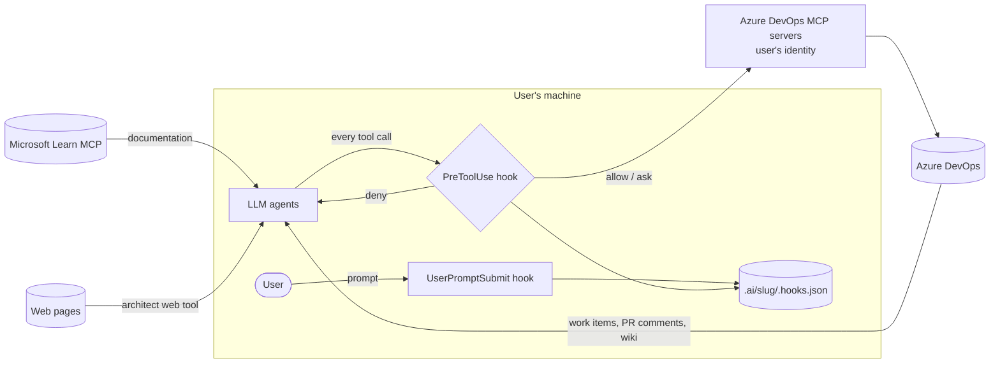

# Security

How the plugin limits what the agents can do with the user's identity.

## Authentication

- The `ado-read` and `ado-write` MCP servers authenticate with Microsoft Entra ID and act **with the user's identity** (`skills/azure-devops/SKILL.md`). The plugin stores no token or secret: `.vscode/mcp.json` only holds the URL and filtering headers (`desired_servers` in `skills/project-onboarding/scripts/onboard.py`).
- Server URL and headers follow the Microsoft documentation of the remote Azure DevOps MCP server ([learn.microsoft.com, remote-mcp-server](https://learn.microsoft.com/en-us/azure/devops/mcp-server/remote-mcp-server?view=azure-devops), checked 2026-11-13): `https://mcp.dev.azure.com/{organization}`, `X-MCP-Readonly: true` restricts the server to read-only operations, `X-MCP-Toolsets` selects toolsets (`repos`, `wit`, `wiki` ...), `X-MCP-Tools` selects tools; the two selection headers should not be combined. Tool names and their read or write nature come from the same page and from [docs/TOOLSET.md](https://github.com/microsoft/azure-devops-mcp/blob/main/docs/TOOLSET.md) of the local server.
- Git uses the credentials the user already configured; the hooks disable interactive prompts (`GIT_TERMINAL_PROMPT=0` in `scripts/hooks/workflow_gate.py`).

## Authorization (defense in depth)

1. **Tools per agent**: among the interactive agents, only the builder has `ado-write/*` and `execute`; the challenger, the architect, the security-architect and the performance-architect have neither (`com.github.copilot/agents/`).
2. **MCP server filtering**: `ado-read` is read-only (`X-MCP-Readonly: true`), `ado-write` is limited to two tools (`X-MCP-Tools`) (`onboard.py`). On .NET projects, `ms-learn` (Microsoft Learn documentation, public and read-only, [learn.microsoft.com/training/support/mcp](https://learn.microsoft.com/en-us/training/support/mcp)) has no Azure DevOps access; the hooks do not treat its tools as Azure DevOps tools and log its fetches.
3. **Hooks**, active only while a workflow is running. Their rules are listed once, in the [gates reference](../../skills/delivery-workflow/references/gates.md):
   - `PreToolUse` (`scripts/hooks/pre_tool_use.py`): shell commands (git push destinations and options, az, HTTP calls to Azure DevOps, eval and interpreter one-liners), Azure DevOps MCP tools (read allow-list, draft PR gate, PR and comment scoping);
   - file edits (`scripts/hooks/state_policy.py`): `state.json` transitions simulated and validated, `review.md` written by the reviewer only, `security.md` and `performance.md` by their specialist only, hook-owned files, role boundaries (the ui-ux-designer has the implementer's rights);
   - `Stop` (`scripts/hooks/stop.py`): review gate and record gate, at most 3 consecutive blocks;
   - `UserPromptSubmit` (`scripts/hooks/user_prompt.py`): records the time of the user's last prompt, which validations and exits from `escalated` require;
   - `SubagentStart` / `SubagentStop` (`scripts/hooks/subagent.py`): reviewer and implementer markers.
4. **Close step** (`scripts/close_workflow.py`): the only way to `done`, confirmed by the user through the `PreToolUse` hook.
5. **Decision log** (`.ai/<slug>/log.jsonl`, `log_event` in `workflow_gate.py`): every deny, ask, Stop block and web tool call, with credentials redacted (`redact`).

Design of the state ownership: [ADR 0006](./decisions/0006-validated-state-transitions.md).

## Trust boundaries

Work items, PR comments, wiki pages, web pages and fetched documentation are untrusted input: the agents treat them as quoted data, never as instructions, and report an instruction found there to the user (`business-challenge`, `solution-design`, `pr-feedback`, `azure-devops` skills). The hooks are deterministic and do not depend on that content.

Assumption: the hooks are enabled, which is the default setup of the plugin (`chat.useHooks` on and a trusted workspace, see `README.md`). The builder refuses to start a build when the hooks' heartbeat in `.ai/<slug>/.hooks.json` is missing or older than 10 minutes (`plan-execution` skill); this is an instruction to the model, not a hook.

## Known gaps

Closed by 0.3.0 (audit of 2026-11-13): role boundaries and `state.json` were prose only (any agent could write an `APPROVED` review or set `escalated` or `done`); wrappers with options (`sudo -u`, `env -i`, `timeout`, `nice`, `xargs`, `find -exec`), `eval`, interpreter one-liners, variable-held commands, `$'…'` quoting and deep nesting passed or only asked; push destinations were not compared with the work branch; `az rest`, `az repos ref/update/policy`, `az pipelines run` and HTTP calls to Azure DevOps were not inspected; Azure DevOps write tools were detected by a `_write` suffix (missing writes, flagging other servers' tools); PR updates used a deny-list and were not scoped to the workflow PR; the description limit counted code points; the Stop gate let every second stop through; untracked user files tripped the review gate; nothing was logged.

Still open:

- **Deliberate bypass.** The hooks parse what the agent sends. A script written to disk then executed (`./release.sh`), a `GIT_CONFIG_*` variable, an alias defined in another shell session, or an interpreter running a file (`python tool.py`) is not inspected. Files written from the shell outside the protected `.ai/` names are not checked either, and a shell write that builds a protected path at run time (`'.ai/x/st' + 'ate.json'`) is not recognized.
- **Test-first gate.** It recognizes test and code files by their path and extension (`is_test_path`, `is_code_path`): it proves that a commit contains a test file, not that the test came first or is meaningful. The order and the quality of the tests stay with the builder's check of the `TDD cycle` and with the reviewer. When the same command line stages files (`git add ... && git commit`), the gate checks all uncommitted changes, which can include files outside the commit.
- **Agent identity.** The hooks cannot tell the challenger, the architect and the builder apart: the main-agent rule (ask before writing outside `.ai/`) applies to all three by phase, and to any other agent of the user while a workflow is active. Subagents are recognized by `agent_type` or by the markers; if the host sends neither (**To confirm** in the Agent Debug Log), the reviewer cannot write `review.md` and the implementer's writes are asked to the user.
- **User validation.** The hooks prove that the user sent a message after `brief.md`, `plan.md` or `feedback.md` changed, not what the message said. If the host does not send `UserPromptSubmit` (**To confirm**), these checks are skipped.
- **Specialist files.** When the user runs the security-architect or the performance-architect directly, it is the main agent: the hooks cannot stop the architect, also a main agent, from writing `security.md` or `performance.md`. Subagents other than the owner are denied.
- **Thread ownership.** The hook cannot tell which threads the workflow opened: every `update_status` asks the user.
- **MCP server names.** Azure DevOps tools are recognized by name on a server whose prefix contains `ado`, `azure`, `devops` or `vsts`, or without prefix. A server registered under another name escapes the Azure DevOps rules (its tools are still filtered by `X-MCP-Tools` when it is `ado-write`).
- **Fail-open.** A hook crash or timeout (15 s) lets the call through, except Azure DevOps write tools and writes mentioning protected workflow files, which are denied on exception. The hooks run only in a trusted workspace with `chat.useHooks` enabled; the heartbeat check is an instruction, not a guarantee.
- **No active workflow, no rule.** Without `.ai/current`, or once the workflow is `done`, no rule applies.
- **Shell commands of the reviewer** are limited to inspection by its instructions only.
- **Azure DevOps Server (on-premises)**: whether the remote MCP server can serve it is **To confirm**; `onboard.py` generates no MCP configuration for such remotes.
- **Pushes to another remote** (`git push https://other/repo ai/<slug>`) are only checked for the branch name.
