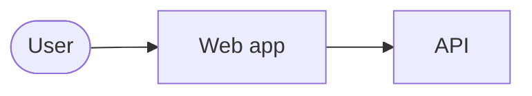

# <Page title>

<One or two sentences: what this page answers.>

## <Section>

<Facts, each with its source: `src/path/file.ext`.>

**To confirm:** <what the code does not prove, or remove this line.>
